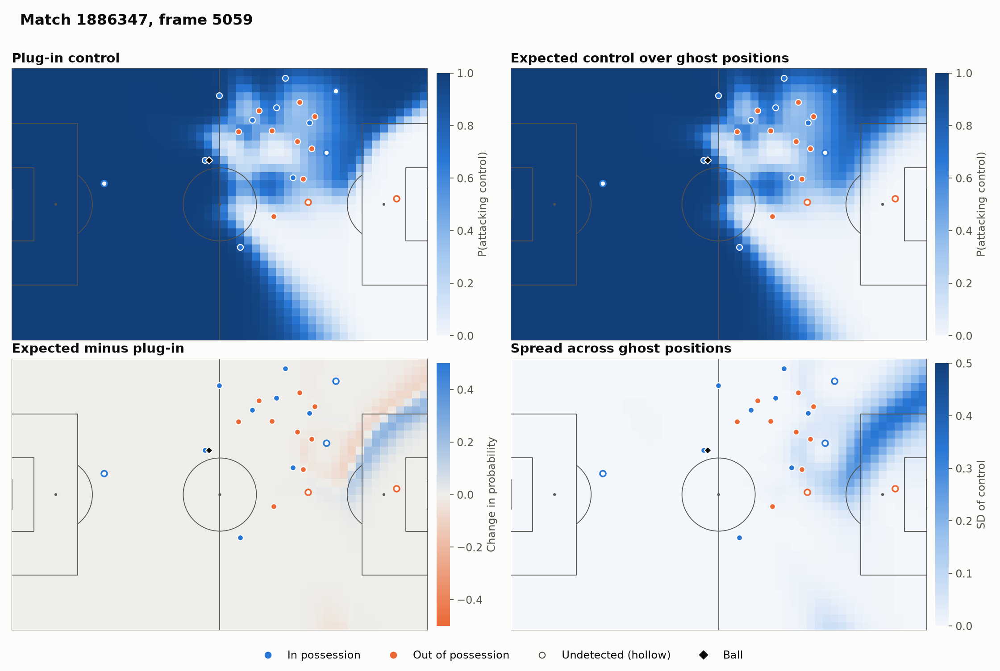
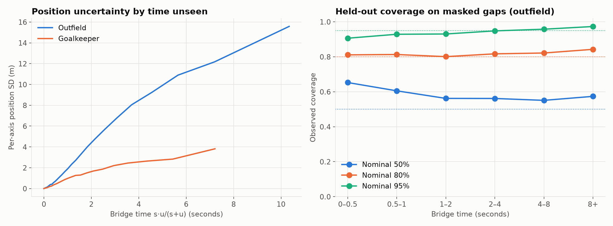

# Schrödinger Pitch Control

An extension of Spearman's pitch control model to broadcast tracking data, where the position of every off-camera player is a random variable rather than an observation.

## Pitch control in football

Pitch control asks a simple question: if the ball were played to a point on the pitch now, which team would win it? William Spearman's "Beyond Expected Goals" (2018) answers it as a probability, built from how quickly each player can reach that point. The result is a surface over the whole pitch, updated at every frame.

Clubs and analysts use surfaces like this to:

- **Evaluate passes:** weigh the risk of a pass against what it would gain, including passes that were never played.
- **Value movement off the ball:** measure the space a run creates or removes for teammates.
- **Assess defending:** see which zones a press or defensive shape actually denies.
- **Prepare for opponents:** compare how teams create and concede space over many matches.

All of these assume that every player's position is known. Optical tracking in stadiums nearly provides that, but broadcast tracking does not: the camera follows the ball, and in the match studied here 40.7% of player-frames are undetected. Broadcast data is what makes this analysis available beyond a club's own stadium, so it matters how much those unseen positions change the answer.

This project replaces the unknown positions with distributions. Until a player is detected again, their position is a distribution rather than a point, hence the name. The metaphor ends there: the model is classical probability.

## The Spearman model

Let $z \in \mathbb{R}^2$ be a target location, $T_b(z)$ the ball's arrival time, and let player $j$ have position $x_j$, velocity $v_j$ and control rate $\lambda_j$.

**Arrival time.** A player continues at velocity $v_j$ for a reaction time $t_r$, then runs straight at maximum speed $v_{\max}$:

$$
\tau_j(z) = t_r + \frac{\lVert z - (x_j + v_j t_r) \rVert}{v_{\max}}
$$

**Arrival uncertainty.** The probability that $j$ has arrived by time $t$ is logistic, with $\sigma$ the standard deviation, so the scale is $\sigma\sqrt{3}/\pi$:

$$
f_j(t, z) = \left[1 + \exp\left(-\frac{\pi}{\sqrt{3}\,\sigma}\,\bigl(t - \tau_j(z)\bigr)\right)\right]^{-1}
$$

**Control.** Control accumulates as a competing-risks system from the moment the ball arrives:

$$
\frac{d}{dt}\mathrm{PPCF}_j(t, z) = \Bigl(1 - \sum_k \mathrm{PPCF}_k(t, z)\Bigr)\, f_j(t, z)\, \lambda_j,
\qquad t \ge T_b(z)
$$

### Closed form

Write the hazards $h_j = \lambda_j f_j$, the total $L = \sum_k h_k$, and the uncontrolled probability $R = 1 - \sum_k \mathrm{PPCF}_k$. Summing the system gives $\dot R = -LR$, so

$$
R(t) = \exp\left(-\int_{T_b}^{t} L(s)\,ds\right),
\qquad
\mathrm{PPCF}_j(t) = \int_{T_b}^{t} h_j(s)\, R(s)\, ds .
$$

Three properties follow:

1. **Probability.** $\mathrm{PPCF}_j \ge 0$ and $\sum_j \mathrm{PPCF}_j = 1 - R \le 1$.
2. **Completeness.** If some $\lambda_j > 0$, then $f_j \to 1$, so $\int L = \infty$ and $R \to 0$. Control is eventually fully assigned at every location, however far the nearest player.
3. **Monotonicity in arrival time.** Let $A, D$ be the cumulative hazards of the attackers and defenders. Integrating by parts,

$$
\mathrm{PPCF}_{\mathrm{def}}(T) = e^{-A(T)}\bigl(1 - e^{-D(T)}\bigr) + \int_{T_b}^{T} \bigl(1 - e^{-D(s)}\bigr)\, \dot A(s)\, e^{-A(s)}\, ds,
$$

which is pointwise increasing in $D$. Lowering a defender's $\tau_j$ raises $f_j$ pointwise, so it can't reduce defending control.

The monotonicity is in $\tau_j$, not distance. A player whose reaction point has already passed $z$ can arrive later by starting nearer to it.

Label symmetry likewise needs care: swapping two teams swaps control only if each $\lambda_j$ moves with its player.

### Discretisation

Holding each $h_j$ constant over a step of length $\Delta t$ solves the system exactly on that step:

$$
R' = R\, e^{-L \Delta t},
\qquad
\mathrm{PPCF}_j' = \mathrm{PPCF}_j + (R - R')\,\frac{h_j}{L}.
$$

Forward Euler has $R' = R(1 - L\Delta t)$, which changes sign when $L\Delta t > 1$. The update above preserves property 1, including $\sum_j \mathrm{PPCF}_j + R = 1$, for every $\Delta t$. Hazards are evaluated at the step midpoint.

Integration stops per cell once $R < 10^{-3}$, so the horizon adapts to the location. It starts at $\max\bigl(T_b,\ \min_j \tau_j - 3.5\bigr)$: the hazard skipped before then decays like $e^{-3.5\pi/(\sqrt{3}\sigma)}$.

### Parameters

| Symbol | Meaning | Value |
|---|---|---|
| $t_r$ | Reaction time | 0.7 s |
| $v_{\max}$ | Maximum speed | 5 m/s |
| $\sigma$ | Arrival-time SD | 0.45 s |
| $\lambda$ | Control rate | 4.3 s⁻¹ |
| $\kappa$ | Defender rate multiplier | 1 |
| $\lambda_{GK}$ | Defending goalkeeper rate | $3\lambda$ |
| $v_b$ | Ball speed | 15 m/s |
| $\Delta t$ | Time step | 0.04 s |

These are the defaults of Laurie Shaw's public implementation. They have not been fitted to this data.

## The extension: control under position uncertainty

Partition the players into detected $\mathcal{D}$ and undetected $\mathcal{U}$. Let $\Phi(X; z)$ be attacking control at $z$, given the joint configuration $X$. The object of interest is not $\Phi$ at a point estimate, but the law of $\Phi(X; z)$ under the distribution of $X_{\mathcal{U}}$ given the data.

### A bridge model for unseen players

In this dataset, off-camera tracks end a median of about 0.2 m from the next detection at every gap length, so they appear to be conditioned on the future. (This is inferred from the data, not documented by SkillCorner.) The natural model is therefore a bridge, pinned at both detections.

For a player last seen $s$ seconds ago and next seen in $u$ seconds, a Brownian bridge has variance $\sigma_B^2\, s u / (s + u)$. This suggests the **bridge time**

$$
\tau_B = \frac{s u}{s + u}, \qquad \tau_B \to s \ \text{ as } u \to \infty.
$$

Footballers are not Brownian: short-range motion is ballistic and long-range motion is confined. So only the dependence on $\tau_B$ is kept, and the variance function is estimated non-parametrically:

$$
X_j \mid \text{data} \sim \mathcal{N}\bigl(\mu_j,\ \sigma^2(\tau_B)\, I_2\bigr),
$$

where $\mu_j$ is the SkillCorner position. Estimating $\sigma(\cdot)$ needs ground truth, which unseen players can't provide. Instead, gaps drawn from the real gap-length distribution are hidden inside detected tracks, and the true positions are compared with the chord between the gap's endpoints. The binned root-mean-square error gives a monotone, piecewise-linear $\hat\sigma(\tau_B)$. Goalkeepers have a separate curve, because they are mostly undetected yet move far less.

Measured spread is close to isotropic: the ratio of longitudinal to lateral SD is between 0.94 and 1.08 from 0.5 s to 5 s.

### The camera as evidence

Being undetected is itself information: the player is probably outside the camera polygon $C_t$. With

$$
\rho = \frac{P(\text{undetected} \mid x \in C_t)}{P(\text{undetected} \mid x \notin C_t)} \approx 0.025,
$$

the density becomes

$$
\pi_j(x) \propto \mathcal{N}\bigl(x;\ \mu_j,\ \hat\sigma^2 I_2\bigr)\, \rho^{\mathbf{1}\{x \in C_t\}} .
$$

A hard exclusion, $\rho = 0$, would be wrong: detection also fails inside the view. Samples come from sampling-importance-resampling, with eight proposals per draw.

### Expected control

Given $K$ joint draws $X^{(1)}, \dots, X^{(K)}$, with $\mathcal{U}$ independent and $\mathcal{D}$ fixed,

$$
\hat m(z) = \frac{1}{K} \sum_{k=1}^{K} \Phi\bigl(X^{(k)}; z\bigr),
\qquad
\hat s^2(z) = \frac{1}{K} \sum_{k=1}^{K} \bigl(\Phi(X^{(k)}; z) - \hat m(z)\bigr)^2 .
$$

The joint draws matter. $\Phi$ is nonlinear in $X$, so by Jensen-type effects $\mathbb{E}[\Phi(X; z)] \ne \Phi(\mathbb{E}[X]; z)$. Averaging hazards doesn't work either: because $R = \prod_j \exp(-\int h_j)$,

$$
\mathbb{E}[R] = \prod_j \mathbb{E}\Bigl[\exp\Bigl(-\int h_j\Bigr)\Bigr] \ne \exp\Bigl(-\sum_j \int \mathbb{E}[h_j]\Bigr)
$$

even with independent players, and the two sides differ by Jensen's inequality. The surface $\hat s(z)$ is a genuine per-location uncertainty band, and

$$
\Delta(z) = \hat m(z) - \Phi(\mu; z)
$$

measures how far the point estimate departs from the mean. Functionals are reported as integrals, $\int \Delta\,dz$ and $\int |\Delta|\,dz$ in m², so they don't depend on grid resolution.

## Results

From match 1886347 only, using seed 20251228. Full tables are in [`results/REPORT.md`](results/REPORT.md).



**Position model.** On gaps held out from the second half, outfield coverage is 59.5% / 81.3% / 93.1% at nominal 50 / 80 / 95%. Real errors are more peaked than a Gaussian.



**Control.** Across 200 frames, the median of $\int|\Delta|$ is 166 m² on a 7,072 m² pitch, and the median of $\int\Delta$ is −6 m². Uncertainty redistributes control much more than it favours either team. At frame 5059, $\hat s$ reaches 0.35.

**Passes.** PPCF at the target predicts completion across 886 passes, with log loss 0.375 once calibrated, against 0.464 for the base rate. On the 189 passes an unseen player could plausibly reach, $\hat m$ gains +0.0055 in log loss over the plug-in, with a 95% bootstrap interval of −0.0057 to +0.0189 over phases of play. That is inconclusive: this match doesn't show that modelling uncertainty predicts passes better. SkillCorner's xPass scores 0.248 on 837 of these passes, against 0.340.

**Visibility.** Players are undetected in 40.7% of all player-frames, rising to 50.1% below 2 m/s and falling to 11.6% at sprint speed. The likely reason is that the camera follows the action.

## Assumptions and limitations

- **Independence.** Unseen players are drawn independently, though team shape correlates them.
- **Offline.** The bridge uses future detections, so it can't run live, and pass forecasts may benefit from information after release.
- **Velocity is fixed.** Only position is random in $X_{\mathcal{U}}$.
- **Calibration is on-camera.** Masked gaps come from detected tracks, where behaviour may differ, and gaps longer than any detected run can't be masked. $\hat\sigma$ is held constant beyond its range.
- **Ball.** Constant speed and a straight line, with no height, drag or interception en route. 17.7% of known ball positions are extrapolated but treated as observed.
- **Pass targets.** 17.5% are undetected, so the target location is itself an estimate.
- **Players.** All share one speed and reaction time, and offside is not modelled.
- **Parameters.** Taken from Shaw's code, and not checked against the 2018 paper.
- **Sample.** One match. Off-camera speeds are also estimates, so visibility rates are approximate.

## Running it

Tested on Python 3.13.

```bash
pip install -r requirements.txt
python -m schrodinger_pitch
```

This takes about 11 minutes and writes figures, `metrics.json`, `ghost_model.json` and `REPORT.md` to `results/`. Add `--n-frames 20 --n-draws 16` for a quick pass. `--match-id`, `--frame`, `--seed`, `--data-dir` and `--output-dir` are also available.

The code expects [SkillCorner's open data](https://github.com/SkillCorner/opendata) in `./data`, or at the path in `--data-dir` or `SCHRODINGER_DATA_DIR`. Data is read but never written. Match files stored with Git LFS need `git lfs pull` first.

```bash
pip install -r requirements-dev.txt
pytest
```

The tests check the properties above with Hypothesis, along with the analytic one-player solution $\mathrm{PPCF}(T) = 1 - \exp\bigl(-\lambda \int_0^T f\bigr)$.

```
schrodinger_pitch/
  control.py       pitch control
  ghosts.py        bridge model and sampling
  uncertainty.py   expected control
  validation.py    position and pass validation
  audit.py         visibility by speed and zone
  data.py, kinematics.py, figures.py, pipeline.py, config.py
tests/
results/
legacy/            the original competition code
```

## References

- W. Spearman (2018). *Beyond Expected Goals*. MIT Sloan Sports Analytics Conference.
- L. Shaw. [LaurieOnTracking](https://github.com/Friends-of-Tracking-Data-FoTD/LaurieOnTracking), reference implementation.
- Data: [SkillCorner](https://skillcorner.com) open data, released with [PySport](https://pysport.org).

## Licence

The code is under the [MIT License](LICENSE). SkillCorner's data and `opendata-master/` are not covered by it; `opendata-master/` has its own licence.
